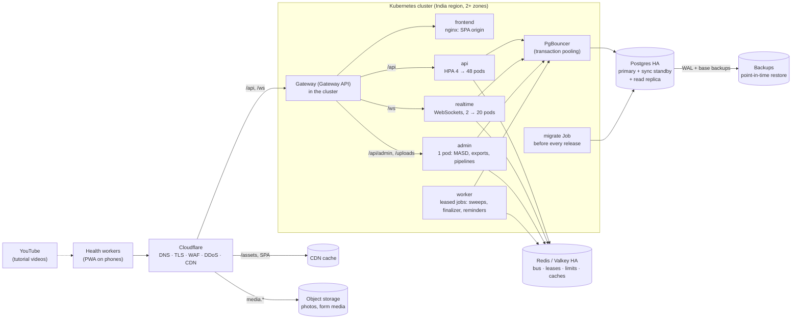

# EduPoshan for 300,000 health workers — target architecture

Status: design + Phase 0 implemented (Nov 2026).
Companions: `deploy/helm/eduposhan/` (the Kubernetes chart), `loadtest/` (Locust),
`deploy/LIVE_TESTING_AT_SCALE.md` (today's exam overlay on narmada), `SECURITY.md`.

## 1. Short answer

Yes. A lot of what 300,000 workers need is already in the code. Patient-data audit
chains are kept per process, so there is no global lock. Live monitoring fans out
through Redis, and background jobs take Redis leases. The SPA's build files are
content-hashed, so a CDN can cache them. A PgBouncer overlay and a read-replica
switch already exist.

What's missing is a platform built to scale out. Today everything is **one
docker-compose stack on one server (narmada)**:

- migrations and background jobs run inside the web workers;
- media and pipeline files sit on that server's disk;
- caches are held per process;
- the heaviest dashboards are recomputed on every request.

This plan moves EduPoshan to Kubernetes behind Cloudflare, with a highly available
Postgres and Redis. It runs in four phases. Each phase ends with a load test that has
to pass before the next one starts.

## 2. What 300,000 workers means

The ratios come from two places. From the live copy (Nov 2026):

- 8.4 mothers per adopting worker;
- about 75 form responses per worker so far, about 2.5 KB each;
- every tutorial video on YouTube.

From `loadtest/REPORT.md`: one backend process serves about 100–300 req/s of the real
learner journey, and sign-in reached 206/s on narmada's 64 cores (bcrypt cost 12).

| Quantity | Assumption | Result |
|---|---|---|
| Daily active workers (field phase) | 50% of 300k | 150,000 |
| API calls per active worker per day | home, 2–3 forms per visit, baby page, charts | ~60 → 9 M/day |
| Field peak: the 10–11 am hour carries ~15% of the day, ×3 for bursts | | **~1,100 req/s** |
| Training: viewers in the peak hour (player beats every ~10 s, `TutorialPlayerPage.tsx`) | 20% of a 100k cohort | 20,000 → 2,000 req/s |
| Exam wave | 50,000 candidates at once | ~1,100 answer saves/s, **50,000 WebSockets**, ~3,300 WS msg/s (30 s heartbeats) |
| **Design target** | | **5,000 req/s sustained, 10,000 burst; 60,000 WebSockets** |
| Mothers / babies | 8.4 per worker | ~2.5 M / ~2 M |
| Form responses | ~19 per worker per month | ~5.6 M rows/month: ~14 GB of data, ~25–30 GB with indexes |
| Audit events | ~30 audited patient-data calls per active worker-day | ~4.5 M/day (~1.6 B/year), the largest table by far |
| Growth photos (if 30% of checks carry one, ~250 KB) | | ~170 GB/month, in object storage |

What the platform is sized to deliver:

| Objective | Target |
|---|---|
| Availability per month | 99.9% (≈ 43 min down) |
| Field APIs, p95 | < 500 ms |
| Exam answer save, p95 | < 300 ms, with no answer lost |
| Data loss / recovery time | ≤ 5 min / ≤ 1 h |

## 3. Where today's design stops scaling

| # | Today | Why it breaks at scale | Fix (phase) |
|---|---|---|---|
| 1 | One server, one Postgres, docker-compose | No failover. A disk or host failure is an outage. One box is the ceiling. | Kubernetes, HA Postgres (1) |
| 2 | Every worker runs `alembic upgrade head` + seed at boot (`main.py` lifespan) | Every pod start queues on the advisory lock, and schema changes land mid-rollout | Migration **Job** before each release. Pods only verify the schema (**0, done**) |
| 3 | Security sweeper, attempt finalizer and care reminders run inside every web worker | Web pods do batch work, and scaling the web tier multiplies idle loops | A separate **worker** process, `python -m app.worker` (**0, done**) |
| 4 | At boot, `fail_stale_runs()` fails every running pipeline run started on *another host* | With pods, every new or rescheduled api pod kills the admin pod's running pipelines | Only the pod that runs pipelines cleans them up: `OWNS_PIPELINE_RUNS` (**0, done**) |
| 5 | Rate-limit counters live in Redis with no fallback (`rate_limit.py`) | If Redis goes down, sign-in, OTP and exports start returning 500 | Fall back to per-process counters until Redis returns (**0, done**) |
| 6 | Audit and rate limits take the client IP from the left-most `X-Forwarded-For` hop | Behind Cloudflare a client can plant that hop, which mis-attributes rows in the audit trail | `CLIENT_IP_HEADER=cf-connecting-ip` (**0, done**). The origin accepts only Cloudflare. |
| 7 | No health endpoints. The compose probe calls `/` with a hand-built Host header. | Kubernetes needs liveness and readiness that mean something | `/healthz` + `/readyz` (**0, done**) |
| 8 | Learner photos and form-builder media go to `/app/uploads` when R2 is off | With several pods, a photo lands on whichever pod took the upload | R2 (already built behind `R2_*`) is **required** for the cluster. The chart refuses to render without it (1). |
| 9 | Session and user caches are per process (`security/sessions.py`, 30 s TTL) | With 60+ processes almost every request misses its cache: 2 extra queries per call | Shared Redis cache with a small in-process L1 (2) |
| 10 | Home "Today" view (`fieldplan.today_view`, ~1.2 s per call locally) and team views are recomputed per request. Part of what they load (the calendar) covers the whole project. | 150k workers × ~5 home loads a day ≈ 10 vCPU all day, ~40 vCPU in the peak hour, and it grows with the project | Cache per worker, keyed by a per-user write version (2) |
| 11 | MASD, Programme Progress and growth summaries load a whole project per page view (`masd/data.py:load`) | A state project at this scale is millions of rows per view | Aggregates precomputed by the worker. Exports become jobs on the read replica. (2) |
| 12 | The audit fallback spool is a file in the container (`AUDIT_SPOOL_PATH`) | A pod deleted while the database is down would lose spooled evidence | One persistent volume per pod (StatefulSet) now (1). A shared durable spool later (2). |
| 13 | Big tables are unpartitioned (`form_responses`, `audit_events`, `notifications`) | Index and vacuum costs grow every year, and old data can't be archived | Monthly partitions. Audit kept 90 days hot, older months archived. (2) |
| 14 | One progress write per ~10 s of video watched | 20k viewers = 2,000 writes/s just for progress | Client batches to 30–60 s, and the server writes in batches (2) |

## 4. Target architecture

### 4.1 Edge: Cloudflare
- DNS and TLS go through Cloudflare, which re-encrypts to the cluster's Gateway. The
  origin firewall admits only Cloudflare's IP ranges, or Cloudflare Tunnel is used, so
  nobody can reach the origin directly and forge client headers.
- **The SPA is served from the CDN cache.** `frontend/nginx.conf` already marks
  `/assets/*` as `immutable` and `index.html`/`sw.js` as `no-cache`, so the origin
  sees almost no static traffic, and the service worker keeps working unchanged.
- **Media**: switch on R2 (`app/storage.py`) behind a custom domain such as
  `media.<domain>`. R2 has no egress fees and its objects are CDN-cached. Add the
  domain to the CSP's `img-src`/`media-src`. *Residency check:* at the time of
  writing R2 has no India-only jurisdiction. If the MOU requires photos to stay in
  India, use an India-region S3-compatible bucket instead. That needs a small change
  to make `storage.py`'s endpoint configurable.
- **Edge rate limits** on sign-in, OTP and sign-up stop floods before they reach the
  pods. The per-account lockout (`security/lockout.py`) is still the real defence
  against password guessing.
- **Real client IP**: set `TRUST_PROXY_HEADERS=true` and `CLIENT_IP_HEADER=cf-connecting-ip`.
  Cloudflare overwrites that header on every request, so it can't be planted.
- **Videos stay on YouTube for now**: free, adaptive bitrate, and its own CDN. Later
  option: 240p/360p/480p HLS on object storage, which gives ad-free playback and
  offline download in the PWA for the cost of storage only.

### 4.2 Workloads: one image, four roles
The backend image is the same everywhere. A pod's role comes from its command and
settings.

| Workload | Kind | Serves | Scaling | Settings |
|---|---|---|---|---|
| `frontend` | Deployment | SPA origin for the CDN | HPA 2 → 6 | nginx, unchanged image |
| `api` | StatefulSet | `/api/*` except admin | HPA 4 → 48 on CPU | `RUN_MIGRATIONS_ON_START=false`, `RUN_BACKGROUND_TASKS=false`, `OWNS_PIPELINE_RUNS=false`; 1 uvicorn worker per pod |
| `realtime` | StatefulSet | `/ws/*` live monitoring + proctoring | 2 → 20; **pre-scaled before exams** | same as api. Redis pub/sub already shares state across pods. |
| `admin` | StatefulSet (1 pod) | `/api/admin/*`, `/uploads/*`: MASD, exports, pipelines, form-builder media | fixed at 1 for now | `OWNS_PIPELINE_RUNS=true`, plus the pipeline volume |
| `worker` | StatefulSet (1–2 pods; leases pick one) | security sweeps + audit anchors, attempt finalizer, care reminders; later the aggregates | fixed | `python -m app.worker` |
| `migrate` | Job (Helm pre-install/pre-upgrade hook = Argo CD PreSync) | `alembic upgrade head` + seed | once per release | uses the **direct** DB URL (advisory locks don't belong on a pooler) |

Why these choices:
- **Separate `realtime` and `admin` tiers** keep each problem contained. An exam
  wave of 50k sockets, or an analyst exporting a district, can't starve the field
  workers' traffic, and each tier scales on its own signal.
- **StatefulSets** give every backend pod a small persistent volume for the audit
  spool (#12) and a stable name. They still scale under an HPA.
- **Autoscaling can't move a WebSocket that is already open.** New realtime pods
  only receive new connections, so exam days raise `realtime.minReplicas` ahead of
  time (`values-exam-day.yaml`).
- **Routing uses the Gateway API (HTTPRoute).** The ingress-nginx project was retired
  by Kubernetes in March 2026 and gets no more security fixes. Envoy Gateway is the
  portable default, and the chart also renders a classic `Ingress` for clusters that
  already run a supported controller.

### 4.3 Data tier
- **Postgres 16, highly available**: a primary plus a synchronous standby in a second
  zone with automatic failover, and one async read replica for admin dashboards,
  exports and analysts. Start at 8–16 vCPU / 64–128 GB with NVMe-class storage, and
  grow from what the Phase 2 test shows.
  - Option 1: a managed service in an India region (RDS, Azure Flexible Server or
    Cloud SQL).
  - Option 2: in-cluster **CloudNativePG** with 3 instances, its own PgBouncer
    `Pooler`, and WAL archiving to object storage. This is the separate manifest
    `deploy/k8s/cloudnativepg.yaml`, applied once before the chart. A database
    must not share the app release's lifecycle: one `helm uninstall` would reach
    the data.
- **PgBouncer in transaction mode** (`deploy/pgbouncer/pgbouncer.ini` already
  describes it): 48 api pods × pool 10 ≈ 500 client connections become ~150 server
  connections.
- **Read routing**: `READ_DATABASE_URL`/`get_read_db` already exist for reference
  data. Extend them to admin dashboards and exports (Phase 2).
- **Partitioning** (Phase 2, online, with `pg_partman`): `audit_events`,
  `form_responses` and `notifications` split by month. Older audit months move
  compressed, anchors included, to object storage under the policies in
  `app/security/retention.py`.
- **Backups**: continuous WAL archiving plus nightly base backups give point-in-time
  restore with ≤ 5 min of data loss. A restore is rehearsed every month.
- **Redis or Valkey, highly available**: managed, or self-hosted primary/replica with
  Sentinel behind one stable address (the app takes a single `REDIS_URL`). It holds
  the pub/sub bus, leases, rate-limit counters, and later the shared caches. If it
  goes down, pods that are already running keep serving: limits fall back per
  process (#5), leases aren't granted so jobs pause, and live monitors only see
  candidates on their own pod. New pods can't start until Redis returns, because
  `ws_manager.start` pings it at boot. That is why Redis must be HA.

### 4.4 Patient-data protection at scale (SECURITY.md remains the rulebook)
- Audit chains are per process (`security/audit.py:_CHAIN_KEY` = host:pid:boot). More
  pods only means more chains. The anchor job, held by one lease in the worker,
  notarises all of them. Nothing in this design touches `_HASHED_FIELDS` or
  `canonical_payload`.
- Encryption, index and audit keys move from `.env` into a secret manager (cloud KMS
  or Vault, synced by External Secrets). The chart only *references* one Kubernetes
  Secret and never stores a value.
- Data residency: everything that stores patient data stays in India, as the MOU
  requires. That covers Postgres, backups, Redis, logs and the photo bucket (see the
  R2 note in 4.1).
- NetworkPolicies allow only the app pods to reach the database and Redis, and only
  the Gateway to reach the app pods.

### 4.5 Observability
- kube-prometheus-stack (Prometheus, Grafana, Alertmanager), plus Loki for logs. Log
  redaction already happens inside the app.
- Gateway/Envoy metrics and postgres-exporter.
- Dashboards track the objectives in §2. Alerts fire on:
  - p95 latency and 5xx rate;
  - DB pool waits and replication lag;
  - audit queue depth and spills (`audit.stats()`);
  - Redis memory.
- An app-level `/metrics` endpoint waits until dependencies are pinned (risk 1).

### 4.6 Delivery
CI already pushes `ghcr.io/…/backend:sha-*` and `…/frontend:sha-*`. Phase 1 replaces
the self-hosted `docker compose` deploy with **Argo CD**, which applies this chart at
the new tag:

1. The migrate Job runs.
2. A rolling update proceeds, protected by PodDisruptionBudgets.
3. If readiness fails, the rollout stops before any traffic moves.

Migrations follow expand → deploy → contract: add the new shape, ship code that uses
it, and drop the old shape a release later. Because of that, old pods keep working
during a rollout. A pod whose code is *newer* than the database refuses to start;
one whose code is *older* starts with a warning, so a rollback stays possible.
docker-compose remains for local development and as the fallback during the cut-over.

## 5. Phased plan — each phase ends with a load test

| Phase | When | Scope | Exit test |
|---|---|---|---|
| **0: cluster-ready code** | done here | `RUN_MIGRATIONS_ON_START`, `RUN_BACKGROUND_TASKS`, `OWNS_PIPELINE_RUNS`, `CLIENT_IP_HEADER`; `python -m app.migrate`, `python -m app.worker`; `/healthz`, `/readyz`; limiter fallback; Helm chart | Test suite green. Compose deploy unchanged, because every flag defaults to today's behaviour. |
| **1: platform** | weeks 2–6 | Cluster (3+ nodes, 2 zones), Postgres HA + PgBouncer, Redis HA, Cloudflare in front, R2 on, Argo CD, monitoring. Pin every Python dependency first. Move the data off narmada (dump/restore in a window, or logical replication for near-zero downtime). | Locust at **100k-worker load** (2,000 req/s + 20k sockets) within the objectives; a database failover drill |
| **2: code paths that grow with users** | weeks 6–12 | Shared session/user cache, cached Today and team views, MASD aggregates, batched video beats, partitions + audit archive, read replica for admin, exports as jobs | Locust at **300k load** (5,000 req/s sustained, 10,000 burst, 50k exam sockets) within the objectives |
| **3: resilience** | ongoing | Warm standby in a second region, chaos and restore drills, HLS videos if wanted. Add an analytics store (e.g. ClickHouse) only if aggregates aren't enough. | Quarterly DR drill within the recovery targets |

Starting sizes for the design peak, to be re-tuned after the Phase 1 test:

| Workload | Pods | Each pod |
|---|---|---|
| api | ~30 | 1 vCPU request / 2 limit, 1 GiB |
| realtime | 10–12 during exams (~5k sockets each), 2 otherwise | |
| admin | 1 | 4 vCPU, 8 GiB |
| worker | 1 | 1 vCPU |
| frontend | 2–4 | |

The nodes start at about 8 × (4 vCPU / 16 GiB), bursting to about 20 on exam days.

## 6. Risks
1. **Unpinned dependencies.** Any `requirements.txt` change re-resolves everything:
   SQLAlchemy 2.1 took production down on 29 Sep 2026. Pin everything with hashes
   before adding a library.
2. **Exam sign-in storms.** bcrypt is CPU-bound on purpose. Candidates sign in on
   their own phones days earlier (sessions last), start windows are staggered, and
   edge limits are sized for halls.
3. **Data residency.** Agree the hosting region and photo bucket with the state
   programme before any patient data leaves narmada.
4. **The cut-over.** Rehearse the move twice on a copy, and keep narmada read-only
   as a fallback for one week.

## 7. Decisions needed from the team
1. **Where it runs.**
   - (a) Managed Kubernetes plus managed Postgres in an India region: the least
     operations work, and the recommendation for a 300k programme holding patient
     data.
   - (b) Your own servers (institute or state data centre) with CloudNativePG: less
     money, more people.
   - (c) A government cloud (MeghRaj-empanelled).

   The chart supports all three.
2. **Budget.** Rough order of magnitude for (a) at full scale, at on-demand list
   prices: ≈ USD 6,000–9,000 a month, about half of it the database. One-year
   reservations cut about a third. These are planning estimates, not quotes.
3. **Exam concurrency** to design for. This plan assumes 50k.
4. **How long to keep audit history.** At full scale that's ~1.6 B events a year,
   which drives storage.
5. **Who is on call** once the cluster is live.
